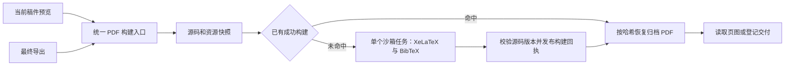

# PaperAgent 评测方案 v1

调研日期：2026-11-15。正式基准仍为方案草案；本轮已实现架构改造和独立试跑 CLI，使用完整 2024 国赛 B 题检查真实工作流。目标是判断系统能否根据给定材料完成计算、保留可复现代码、交付有依据的报告，并记录完成这些工作所需的资源。

当前工作优先级已调整为线上 trace 驱动的 PaperAgent 架构审查；pi 参数/工具对齐不是本轮前置工作。以下对照设计作为后续可选实验保留。综合调查见 `docs/ARCHITECTURE_REVIEW_20261115.md`。

## 现有公开评测

| 评测 | 任务与评分 | 对 PaperAgent 的用途 | 边界 |
| --- | --- | --- | --- |
| [MM-Bench / MM-Agent](https://arxiv.org/abs/2505.14148) | 111 道 MCM/ICM 题，覆盖分析、建模、计算、报告 | 主要外部题源；仓库已有适配器 | 论文 rubric 得分不能直接证明数值正确，也不能等同于竞赛获奖率 |
| [TB-MathModel](https://github.com/wxj630/terminal-bench-math-modeling) | 18 道 2023—2025 国赛/美赛题；结构化数值产物 | 补充国赛题、可计算目标与约束检查 | [论文](https://arxiv.org/abs/2611.08237)提出方向敏感评分、多参考与可行性门禁；当前仓库各题实现需逐题检查。已查的 2024 B 配置仍使用单参考距离公式，不能声称全部实现论文协议 |
| [ScienceAgentBench](https://github.com/OSU-NLP-Group/ScienceAgentBench) | 从 44 篇论文提取 102 个科学数据任务，评价程序、运行结果与费用 | 检验数据处理、分析与科学计算能力 | 使用 2026-04-30 发布的 verified split 与对应 artifacts；遵守其数据分发要求 |
| [DABstep](https://huggingface.co/blog/dabstep) | 450 多个多步数据分析任务；数值容差、字符串/列表规则评分 | 检验异构材料读取、业务规则与答案正确率 | 主要评价简短答案；不覆盖长报告质量。2025 年发布时的模型分数不代表当前水平 |
| [PaperBench](https://github.com/openai/frontier-evals/tree/main/project/paperbench) | 20 篇 ICML 2024 论文复现；生成、全新环境复跑、rubric 评分分离 | 借鉴独立复现和任务拆解评分方法 | 完整任务需要更长预算及 GPU，首轮不整套运行；JudgeEval 也说明评分器本身需要校准 |
| [AstaBench](https://github.com/allenai/asta-bench) | 11 个 benchmark、2,400 多个样例；覆盖检索、代码、分析与端到端发现 | 后续文献检索与跨领域能力扩展；借鉴统一工具和环境 | 多套外部服务、数据和权限依赖，不能以本地小样本替代完整成绩 |

上述信息来自作者论文和官方仓库，检索日期见文首。优先借鉴 MM-Bench 的任务形态、DABstep/ScienceAgentBench 的客观核验、PaperBench 的独立复跑。不同协议和资源下的公开榜单分数不直接横比。

## 现有实现需要补足的部分

`python -m evals` 已能加载 MM-Bench、运行 PaperAgent，汇总论文、运行次数、文件可读性和四维模型评分。当前 `PIPELINES` 实际只有 `research`，旧命令注释中的消融选项不可用。主要缺口是：

- 执行成功、文件能打开、章节齐全，与答案正确是不同指标。
- 已有模型 rubric 主要读取论文文本，没有独立检查原始表格中的指标、可行解或干净环境复跑。
- 旧汇总对缺失分数只平均有值样本，容易掩盖未运行/未评分情况；新协议保留全部计划任务的分母。
- pytest 使用模型和协议替身，保证功能回归；它的通过率不作为真实模型能力成绩。

## 指标和成功标准

各项分别报告，首版不把它们任意加权为一个总分。

| 指标 | 定义 | 核验方式 |
| --- | --- | --- |
| 要求覆盖率 | 已完成并有交付证据的要求项 / 全部预先列明要求项 | 逐小问、逐约束和指定产物核对，不按章节数量替代 |
| 数值正确率 | 独立参考计算通过的任务 / 全部计划任务 | 读取实际 JSON/CSV；容差预先固定；拒绝 NaN/Infinity |
| 可行率 | 全部硬约束通过的优化任务 / 计划优化任务 | 用输出决策重算约束与目标；只写对目标值不算通过 |
| 证据一致性 | 经核查可由本次数据、代码、输出支持的核心结论 / 全部核查的核心结论 | 预先列出必查结论，核对数值、单位、数据范围；引用存在性和引用支持性分别核查 |
| 交付率 | 报告、结构化答案和复现入口均存在且非空的任务 / 全部计划任务 | 检查真实文件；报告覆盖方法、结果、假设和局限 |
| 复现率 | 在新沙箱仅用原始输入与代码重新计算、再次通过核验的任务 / 全部计划任务 | 不复制原运行的结果文件；不在宿主机执行模型代码 |
| 可核验交付通过率 | 预先声明的必做要求、可计算结果/约束、证据核查、交付与独立复现均通过 / 全部计划任务 | 只覆盖列明的检查范围，不等同于研究在科学上完全正确；待复核与环境失败单列，不能静默从分母删除 |
| 报告质量 | 要求覆盖、方法合理性、结果解释、证据一致性、局限 | 正式轮采用匿名、隐藏模型身份的 rubric；独立模型评分加人工抽检；未评分记 NA |
| 效率 | 每题耗时、请求数、输入/输出/cache token、成功任务成本 | 保留真实回执；未知价格/用量记未知，不记成 0 美元 |

对于探索性开放题，没有唯一最优解时，先检查物理/业务可行性，再评价目标与参考解的差距；优于参考且可行的解不受罚。论文内容与代码/结果的证据一致性由离线评测检查，不往生产 Agent 中新增研究验收步骤。

## 每项如何判定

每道题在开跑前形成一份检查表：要求 ID、检查对象、参考值或参考计算、绝对/相对容差、必过/评分项、判定责任（程序/模型/人工）、无法核验时的状态。冻结公开的输出要求与允许误差，参考答案和检查器内部实现对被测 Agent 隐藏。不可在看过结果后调整阈值。

### 有标准计算结果的题：逐字段核验

以等待时间 `[3,4,4,5,5,6,7,22]` 分钟为例，参考结果由独立的标准库计算得到：

| 检查对象 | n | mean | median | sample_sd，ddof=1 |
| --- | --- | --- | --- | --- |
| 全部观察 | 8 | 7 | 5 | 6.187545093630776 |
| 排除第 8 行 | 7 | 4.857142857142857 | 5 | 1.3451854182690985 |

检查器读取实际 `outputs/answer.json` 的八个字段；n 必须为对应整数，其余字段绝对误差不超过 1e-6。NaN、Infinity、缺字段或错误样本口径均不通过。报告中的展示数字按声明的小数位检查舍入一致性，不能拿全文出现过相同数字当作证据。模型没有运行而直接猜中答案，可以通过数值项，但不能因此通过执行证据与复现项。

回归校准题用独立闭式解复算指定训练集的系数、测试预测和误差。输出自称使用正确训练行号不证明没有数据泄漏；还要核对实际读取、拟合和选择参数的代码。开放预测题则冻结训练数据和隐藏测试集，以实际预测重新计算误差，不能要求输出恰好等于某一种参考模型。

### 优化题：检查决策本身

例如最大化 `3x+5y`，约束 `x+2y<=20`、`3x+y<=30`、`x,y>=0`。独立顶点枚举得到最优目标 54。候选答案必须同时满足全部约束、目标重算一致和最优目标容差。`x=18,y=0` 虽然也可写出目标 54，但违反第二条约束，因此不通过。具有多个最优解时，不要求决策向量与参考逐项相等。

真实数模题的约束来自题面及明确声明的建模约定。候选方案改变假设后，原参考最优值可能不可比较，需要标记为不同口径并复核；不能直接认定数值接近获奖论文就科学正确。

### 证据、交付与复现：各自留回执

- 证据：必查核心结论逐条关联报告位置、原始输入、实际执行代码/回执和结果字段；检查数值、单位、时间范围和样本范围。运行日志出现同一个数字，只能说明出现过该输出，不能单独证明计算方法正确。语义上的因果推断、泛化与文献支持需要模型审阅或人工复核。
- 交付：实际打开 JSON/CSV/工作簿，核对必要行列、图表与文件引用；需要 PDF 时实际编译并检查产物。文件存在或章节标题存在不能替代内容核查。
- 复现：从评测侧保留的原始输入新建沙箱，只放入所需代码和明确允许的依赖；不复制旧结果、旧缓存或检查点。重新执行入口、保存退出状态，再对新产物运行同一数值和约束检查器。可复现的错误仍然是错误，因此复现项和正确性项分开。

### 主观研究判断：单独给出评分依据

方法适配性、假设合理性、解释质量、结论边界和局限按逐题 rubric 评价。每项采用 0/1/2 锚点：0 为缺失或有明确错误，1 为有讨论但论证/证据不充分，2 为满足该题列明的证据要求。每个分数必须附报告原文位置、相关输出/来源和理由。

裁判模型看不到系统身份、生成模型或其他系统的成绩。正式扩展前，用经过人工复核的样本测量其一致性和错判；未进行人工复核时，结果只能称“模型裁判评分”。缺乏支持和已经证明错误分别记录；不确定项标记 `needs_review`。首轮小样本逐题展示完整依据供复核，不预设已经取得人工评价。

### 检查器也要先校准

开测前用已知正确产物和故意损坏的产物检查评分器：错误数字、口径改变、违反约束但目标正确、漏掉要求的子问题、结果与报告冲突、缺复现入口等都应被正确区分。评分器异常标记 `grader_error`，保留产物后修复评分器并统一重评，不能记成 Agent 答错，也不能当成通过。候选结果不确定记 `needs_review`；未运行记 `not_run`。这些状态在全部计划任务的汇总中明确列出。

## 分阶段样本

### 首轮：3 题内部校准，单次尝试

这 3 题是我们自建的执行与评分校准集，**不属于 MM-Bench、TB-MathModel 或 ScienceAgentBench 的官方成绩**，也不代表完整科研能力。

| ID | 输入与目标 | 独立核验 |
| --- | --- | --- |
| `statistics` | 等待时间 CSV；全样本及去掉指定极端观察后的样本量、均值、中位数、样本标准差 | Python 标准库 `statistics`；数值绝对误差 1e-6 |
| `regression` | 30 行固定数据；前 20 行拟合含截距 OLS、后 10 行验证；交付预测 CSV | 独立闭式 OLS，训练/测试行号，系数、预测、MAE/RMSE；禁止测试数据参与拟合 |
| `linear_program` | 两变量资源优化；交付决策、目标、可行性解释 | 有理数顶点枚举与输出约束重算，接受任意等价最优解 |

每题要求 `paper.md`、`outputs/answer.json`、`code/reproduce.py`。原始输入仅放入 `data/`；参考计算与评分规则不进入 Agent 工作区。当前校准不包含外部文献任务，不给无引用任务强加引用评分。

默认串行执行，复用本地数据库中用户选择的模型配置；不修改原配置。每题最多 24 次模型请求、180,000 总 token、30,000 输出 token、600 秒墙钟；单请求超时 120 秒。只有配置了确认的价格时，费用值才有意义；这些请求/token 限额不构成美元费用上限。独立复跑另有 120 秒计算超时。预算在开跑前写入协议。

### 第二轮：公开题试跑

优先选 TB-MathModel 的 `cumcm-2024-b-production-decision`，以及 MM-Bench 的 `2023_C`、`2024_C`。先固定源码 commit、完整题面、官方附件、评分实现和资源配额。题目/数据/图片缺失时停止该题，不能静默删附件或改题。

TB-MathModel 当前核查版本为 `f4ea69de420aff2a9b5cff92c5d76f953b171650`。2024 B 的 `tests/score_config.json` 只评价问题 2 情形 1 的单位利润，使用 `1 / (1 + |actual-reference| / scale)`；这既不是四问全对率，也没有独立证明该利润可实现。适配时同时保留官方分数、评分范围和我们补充的约束/复现结果。外部评测代码、参考答案、评分配置与论文解答均不上传给 Agent。

首轮如需降低资源，只能预先声明为缩短预算的试跑；不能把结果直接对比官方 4 小时配置的榜单。完整发布前需要原始官方环境/任务规格的独立复核。

### 正式轮：分层任务与对照

- 先固定 12 道开发题，用于发现集成问题；再固定 24 道不参与开发调参的测试题，涵盖数模、科学数据分析和多源材料。
- 正式测试每题每系统独立 3 次，报告逐次 pass@1 均值与置信区间；另报 3 次全部通过比例。若报告 pass@3，明确它是多次尝试机会，与单次预算不同。
- 主对照改为 pi agent，区分原生工具配置与工具能力对齐配置；详见下文。纯模型直接回答只作为辅助对照，不据此单独声称工作流优越。
- 系统配置、底模比较与消融分开实验；保存 git commit、工作区差异哈希、模型参数、环境版本、数据和 prompt 哈希、预算、失败原因、原始产物与回执。
- 正式测试禁止在线检索该题解答；文献检索任务另行规定允许来源。隐藏评分器和 gold，先提交后评分。对公开题潜在预训练污染，在报告中说明，并补充新生成参数变体及未公开材料。
- 报告质量评分隐藏系统身份，并随机次序；至少抽检 20% 以及全部“数值失败但论文高分”和评分分歧样本。裁判自报置信度仅作复核线索，不能解释为校准后的正确概率。
- 二元成功率使用 Wilson 区间；系统差异在任务层做配对 bootstrap，不把同题 3 次尝试误当完全独立样本。只将小样本用于诊断，不作显著优越结论。

## 与 pi agent 对比

2026-11-15 核查的 pi 官方仓库为 [earendil-works/pi](https://github.com/earendil-works/pi)，固定源码版本 `c3cc91632d0a1950fb122605b190233f2aa0006e`。其[默认编码工具](https://github.com/earendil-works/pi/blob/c3cc91632d0a1950fb122605b190233f2aa0006e/packages/coding-agent/src/core/tools/index.ts)为 read、bash、edit、write；[SDK](https://github.com/earendil-works/pi/blob/c3cc91632d0a1950fb122605b190233f2aa0006e/packages/coding-agent/docs/sdk.md)支持自定义工具和持久会话。[压缩机制](https://github.com/earendil-works/pi/blob/c3cc91632d0a1950fb122605b190233f2aa0006e/packages/coding-agent/docs/compaction.md)也已存在，不能把 pi 当成没有上下文管理的简单循环。

安排两种对照，结论分别报告：

| 配置 | 保留内容 | 可以回答的问题 |
| --- | --- | --- |
| pi 原生配置 | 固定版本的默认工具、原生 prompt/会话/压缩；通过适配器在隔离沙箱中读写和执行 | 在相同底模与资源条件下，完整 PaperAgent 与通用 pi 完成研究任务的实际差异 |
| pi 工具能力对齐配置 | 保留 pi 循环与会话，提供同等研究输入、方法说明和计算/文件/导出能力；记录全部适配差异 | 工具能力差距缩小后是否仍有差异；不能凭这一项单独归因于某一个架构组件 |

模型固定 `gpt-6.1-terra`，同时固定实际 API 路径、推理强度、生成上限、上下文窗口和模型服务端点。保存完全相同的输入材料、任务要求、沙箱镜像、CPU/RAM、网络限制、允许依赖和评分器；不允许 pi 在开发宿主机直接执行。请求/token 预算覆盖主模型、压缩、重试与子任务的实际调用，不能只限制 PaperAgent 或只比较主 Agent 的请求数。pi 使用隔离配置与新会话，防止个人扩展、已有历史和全局 AGENTS/skills 意外进入基线。

研究内核对比从任务提交到最终产物，双方直接进入研究会话；若另测产品完整流程，则 PaperAgent 的消息意图分类、交付等额外调用也计入总费用和耗时。现有 `evals/runner.py` 直接调用 PaperAgent，绕过产品消息分类，因此其时间不能代表完整网页工作流。模型配置当前也经 ModelSpec 单独创建，正式对比前需要记录并对齐完整生成参数，而不只记录模型名称。

除质量指标外，增加首个正确结果耗时、模型/工具/传输/导出的分段耗时、工具 schema 估算 token、未命中缓存的输入 token、压缩次数与压缩后约束保持情况。保留各自正常的上下文策略；专项控制压缩参数的实验另行报告。

## 本轮架构改造与试跑

沿用持久单 Agent、上下文压缩、版本保护和执行回执，补足线上 trace 暴露的工作区能力：

- `workspace_edit` 直接保存 `code/` 和 `config/`，支持同文件批量替换；修改已有文件自动绑定读取版本。Python 源码保存时做语法解析。
- `research_run_file` 按入口与参数运行，记录实际冻结的源码版本；每次仍是远端独立 Python 进程。短计算继续使用 `research_run_python`。
- 执行历史改存 `outputs/code-history/`，默认计算输入仅包含维护的源码、参数和原始资料。合并执行前的三次远端盘点为一次 prepare 操作，保留实际输入快照校验。
- 运行回执保留锁等待、启动、同步、远端快照、执行、输出冻结、交付和归档的时间，以及文件操作次数、确认传输字节、实际 CPU/RAM 和依赖版本。
- 数值计算 Skill 覆盖单位、数组规模、向量化、小规模验证和复现入口。正文支持批量修改，预览当前 PDF 后集中修订；只读复核同步等待完成，预览和导出共用编译缓存。稳定的交叉引用在两遍编译后停止，不再固定运行第三遍。

- 试跑发现原始 PDF 流程图无法直接查看，已让 `research_read_artifact` 支持 `pages`，复用已有 PDF 页图缓存和模型图片输入。无需为看题面在计算沙箱中安装解析库。
- JSON 结果可用 `research_read_artifact(view="structure")` 查看字段、类型和数组样例，再用 `json_pointer="/q2/0/optimum"` 选取实际值。`start` / `limit` 对选中内容继续分页；版本仍是原始文件哈希。字段不存在时返回当前节点的可用字段。
- 长文随结果分节保存：Markdown 用 `writing_edit(append=true)` 追加；TeX 先保存主文件骨架，再逐节保存 `sections/*.tex`，沿用 `input` 依赖和版本快照。恢复上下文列出已保存稿件文件，修改和追加均沿用原有并发保护。
- 沙箱确认消失时停止反复轮询；替换运行时恢复原任务，先读取持久日志和完成回执，没有回执则明确记录丢失，不自动重放计算。独立试跑使用 `paperagent-eval` application 命名空间，并且不携带虚构项目 ID；线上回收器不接管评测沙箱。参数文件同时支持子任务读取，并在前端资料分类中显示。

### 统一执行循环

`PaperAgent` 接收请求，`research/session.py` 准备研究上下文，`Planner` 提供研究专用的准备、工具执行和交付回调；下一次模型调用、工具调用配对及停止边界统一由 `agent/loop.py` 的 `AgentLoop` 决定。研究子任务和论文只读复核也实例化同一循环，仅工具与上下文不同。移除了 LangGraph、图构建器、图 checkpoint 和第二层研究调度循环；保留模型适配器及 LangChain Core 消息类型。

`AgentStore` 保存完整模型消息、会话状态、工具回执以及用于界面展示的 Thread/Turn/Item。研究库保存研究事实，工作区保存文件；外围不再用 `action` 安排下一步。暂停和提问保存会话状态后返回；恢复先接已有工具回执，已提交计算从运行清单恢复，不重新提交。新用户消息取消尚未提交的旧调用。导出是普通工具，成功交付与普通最终回复进入同一个完成回调，核对当前产物后才结束研究。

本轮 `gpt-6.1-sol` 合成 LP/IP 试跑见 `eval_runs/2026-11-15-sol-own-loop-e2e/assessment.json` 和 `trace-review.json`：主会话、研究子会话和只读复核子会话均完成，39 次模型调用成功，独立数值检查 6/6，干净沙箱复现一致，最终导出复用 PDF。首轮曾因私有文件名错误进入产物盘点而中断；修复后恢复原计算，失败与恢复记录均保留。此单样本不用于宣称相对 pi 的质量或效率提升。完整后端回归为 874 项通过，另有 3 个子测试。

### 上下文组织与缓存对照

参考 [Codex 的历史管理实现](https://github.com/openai/codex/blob/main/codex-rs/core/src/context_manager/history.rs)、[OpenAI 的缓存规则](https://developers.openai.com/api/docs/guides/prompt-caching)及 [Anthropic 的上下文设计说明](https://www.anthropic.com/research/effective-context-engineering-for-ai-agents)，采用稳定前缀与追加式观察：初始或恢复时补一次完整状态，其后只追加变更。工具观察在首次投影时移出传输遥测及重复任务输入，原始内容仍可读取；提醒先持久化再发送。输入估算计模型内容与图片，响应头和加密续接字节不按普通文本计量，续接载荷保留。容量清理才允许建立新前缀，普通轮次保持历史不变。

原运行的 104.4 万实际输入中，主会话占 101.6 万。按 `o200k_base` 重建，18 份状态快照在多轮中累计贡献约 38.6 万文本 token；其中原始要求约 14.8 万、文件清单约 6.8 万、运行记录约 5.8 万、计划约 5.7 万。这是本地分词估算，并非供应商逐消息账单。两次历史结果收缩后，实际缓存量均降到约 3900 token。

对照记录在 `eval_runs/2026-11-15-sol-context-optimization/comparison.json`。固定原来的 31 次主会话决策做离线投影，保守输入单位减少约 18.6%，后续 30 次前缀均稳定。相同输入、提示、模型参数及预算的新实跑有 49 次请求：缓存比例从 83.5% 升至 94.1%，未缓存输入从 172432 降到 72228；总输入从 1043973 升到 1214280。新一轮模型做了更多排版往返，实际编译 6 次，原运行为 3 次。因此本次只证明前缀稳定和未缓存输入下降，不宣称全流程总 token 或耗时下降。

新实跑仅有 1 份初始状态与 20 条变更消息，3 个会话冷启动后其余 46 次均为稳定前缀。独立数值检查 6/6，干净沙箱复现一致，最终导出复用 PDF；875 项后端测试与 3 个子测试通过。本轮新增一个内容计量与完整回执测试，其余调整现有缓存、外部编辑和提醒测试。

PDF 预览与最终导出现在共同请求 `paper_project.compile_project`。这一入口负责源码和资源快照、缓存命中、归档 PDF 恢复、不可变快照构建与版本一致的发布；调用方只负责读取当前 PDF 的页图或登记交付。返回的 `compiled` 表示本次是否执行编译，持久 `compile` 字段保留构建回执，两者不混成第二套文档状态。内部归档保留对应构建产物。



同一项目的构建请求由 `paper_build_lock` 串行处理，等待者取得锁后重新检查缓存，避免预览和导出并发重复构建。它与短时 `edit_lock`、沙箱 `execution_lock` 分别对应文档构建、文件提交和远端执行；等待编译不会锁住人工编辑，发布时仍核对原始源码版本。所有 XeLaTeX pass 与所需 BibTeX 在 `latex_worker` 内完成，一次同步输入、一次远端提交、一次收回产物，沿用原有提交/完成回执。BibTeX 在构建目录运行，通过 `BIBINPUTS` / `BSTINPUTS` 查找原始依赖；TeX 的 input、文献与图片路径按项目编译工作目录解析。

首轮新增 `tests/test_scientific_workspace.py` 的三个测试，覆盖实际页图、文件编辑和入口运行、批量修稿并发保护、传输与失败计时。随后为 JSON 读取和增量写作增加三个用例。构建统一后仅新增两个测试函数，覆盖并发构建共享、源码/资源失效、失败保留旧 PDF，以及批量 BibTeX/交叉引用流程；章节路径用例并入原有依赖解析测试。附件哈希和工具数量暂不重写；pi 适配仍为后续独立实验。

从 backend 运行一次独立试跑：先在新目录准备 `inputs/` 原始附件和 `prompt.txt`，然后执行：

```bash
python -m evals.research_trial --out eval_runs/<trial> --config-id <existing-connection-id> --model gpt-6.1-sol
python -m evals.research_trial --out eval_runs/<trial> --resume
python -m evals.research_trial --out eval_runs/<trial> --replay
```

新运行冻结模型、生成设置、源码与输入哈希、预算，记录运行和真实用量；不修改现有模型连接。`--resume` 保留既有预算和累计用量，每段源码配置另存 continuation 回执。`--replay` 从评测侧原始输入、`code/`、`config/`、`data/` 建立全新沙箱，不复制原结果或执行历史，运行 `code/reproduce.py`，以绝对/相对容差 1e-6 比较 `outputs/answer.json`。这项检查证明重复性，数值和建模正确性须另行核验。

## 首轮采用的模型

按用户最新要求，本轮研究、代码和写作使用 `gpt-6.1-sol`，复用用户指定的现有 OpenAI 连接凭据，在隔离评测目录运行。推理强度 medium、单次生成上限 16,000、上下文窗口 128,000；默认每题最多 80 次请求、2,000,000 总 token、90,000 输出 token、2,400 秒累计运行墙钟，单请求 300 秒。此次试跑初始限制是 1,500,000 总 token / 单请求 120 秒；长文超时后以 continuation 回执调整，保留此前失败、用量和原预算记录。实际参数与源码哈希以 `protocol.json` 和 continuation 记录为准；价格未知，不将其报告为零费用。

正式对照先固定同一底模，比较 PaperAgent 与 pi agent，并分别报告原生配置和工具能力对齐配置。跨底模比较另立实验，避免把底模变化误读为系统改进。首轮以独立程序评分和人工抽检为主，不让生成模型给自己的研究打出主成绩；引入 LLM 裁判后应选择独立配置，并用人工样本校准。

## 运行产物

架构试跑 CLI 已保存 `protocol.json`、`run.json`、原始工作区与单独的 `replay.json` / `replay/`。已有运行记录不能覆盖；重测使用新的目录并保留原始失败。上述三题校准、正式 rubric 和 pi adapter 尚未实现，不能把一次架构试跑作为完整 benchmark 成绩。

2026-11-15 的 Sol 试跑已完成：完整回答 2024 国赛 B 题四问，交付 12 页中文 PDF；累计运行 1,278.746 秒，54 次模型请求，已报告 1,668,287 token，另有 3 次不完整请求的用量未知。此前被中断的题面读取试跑另留记录，不能视为无消耗。过程中发生的环境恢复、超时和预算调整均保留在 continuation 与原日志中，故不报告为无人干预 pass@1。

离线诊断的 12 项核查通过，覆盖两种声明策略下的问题 2 成本、问题 3 的 4,096 种不拆解方案及选定最优方案的成本、抽样边界、置信区间和原始材料身份；独立新沙箱复跑 24.405 秒，结构化答案一致。论文以一次含 9 处替换的修订处理排版问题，最终编译警告为零。成果保存在已忽略的 `backend/eval_runs/2026-11-15-sol-research-v2/`，入口是 `assessment.json`。这次没有同底模改造前后或 pi 对照，不能据此给出架构提速百分比或完整科学正确率。

JSON 与增量写作改造后，新增三个用例，全量后端为 872 passed。另做了 Sol 两轮受控工具烟测：先看 JSON 结构、选取检查字段并保存方法节，然后在同一会话选取结果字段、追加结果节并交付；13 次请求，首稿原文保留，工具调用无失败。原始模型调用确认 `view=structure` 一次、JSON 字段选择两次、`append=true` 一次；记录在 `backend/eval_runs/2026-11-15-json-draft-smoke/result.json`。这是工具功能验证，不作为自主建模质量或提速成绩。

随后做了逐项真实链路验收，产物在 `backend/eval_runs/2026-11-15-architecture-acceptance/acceptance.json`。全量后端 872 项通过；修复 JSON 字段路径被界面误当绝对文件路径隐藏的问题后，相关 16 项复测通过，未增加测试函数。真实远端计算通过源码、参数和命令行变更依次得到 14、18、27，上传量依次为 637,243、339、0 字节，执行历史未进入默认输入；每次仅一次 prepare 操作，并有实际环境和分段计时。真实提交回包丢失仍只执行一次；下载失败并替换容器后取回原结果，无新提交；运行中容器消失后 1.161 秒结束原轮询，恢复后明确标记丢失、保留日志，不伪造完成或重算。章节重建会话后保留，批量修改保持原子性和人工编辑冲突保护。实际 PDF 预览命中同一版本缓存，稳定稿件两遍 XeLaTeX 后停止。

同轮 Sol 小样本使用 low 推理、64k 上下文、4,096 输出上限和图片输入，30 次请求、208.654 秒、474,401 输入及 3,088 输出 token。两轮实际调用覆盖技能、题面图像、代码和参数编辑、文件入口、JSON 结构与字段选择、章节保存和追加、固定版本预览与 PDF 交付，工具无失败；方法节原文保留。初版验收收集器读错 manifest 路径，已用原始轨迹重新审计，原错误保留，未补跑模型。该受控任务仅验证功能互通，不能证明数模质量提升。该次试跑时最终导出仍会重复编译；后续已通过上述统一构建入口与单任务编译实现复用，不将历史预览缓存误算为当时已完成的导出优化。

统一构建后的完整新轮使用相同的三情景合成 LP/IP 任务、Sol medium、128k 上下文和 16k 输出上限，记录在 `backend/eval_runs/2026-11-15-sol-unified-e2e/`。28 次请求、274.276 秒、568,536 输入与 8,137 输出 token；独立有理数顶点和整数枚举核验六组结果全部通过，交付两页中文 PDF、零编译警告。三个不同源码版本分别以一个沙箱任务完成两遍 XeLaTeX；最终导出 0.0395 秒，复用最后预览的同一 PDF 哈希，未提交编译。模型请求占墙钟约 72%；一次页码越界自行修正，期间只修正文、不重算。该小样本不能证明总体速度或能力提升。

独立复跑最初在只读输入同步阶段未收到命令退出状态，两轮均确认 `not_submitted`；失败记录保留，未把未知状态视为成功。只读诊断随后三次返回正常；在全新空沙箱、空卷中顺序复跑 18.698 秒，结果一致，记录为 `replay-verified.json`，不覆盖原 `replay.json`。返回帧缺失的根因未确认。最终全量后端 874 项通过；本次只增加两个测试函数，另扩展已有路径与流式元数据测试。

真实运行从数据库读取用户选择的现有配置，只保留非敏感模型元数据，不修改原配置。结果放在已忽略的 `backend/eval_runs/` 下；凭据、完整私有数据与访问链接不提交到仓库。本次执行环境预检在独立目录中验证了真实 Python、文件传输、中文 PDF 和 Word 导出；它属于基础设施预检，不是能力评测结果。
