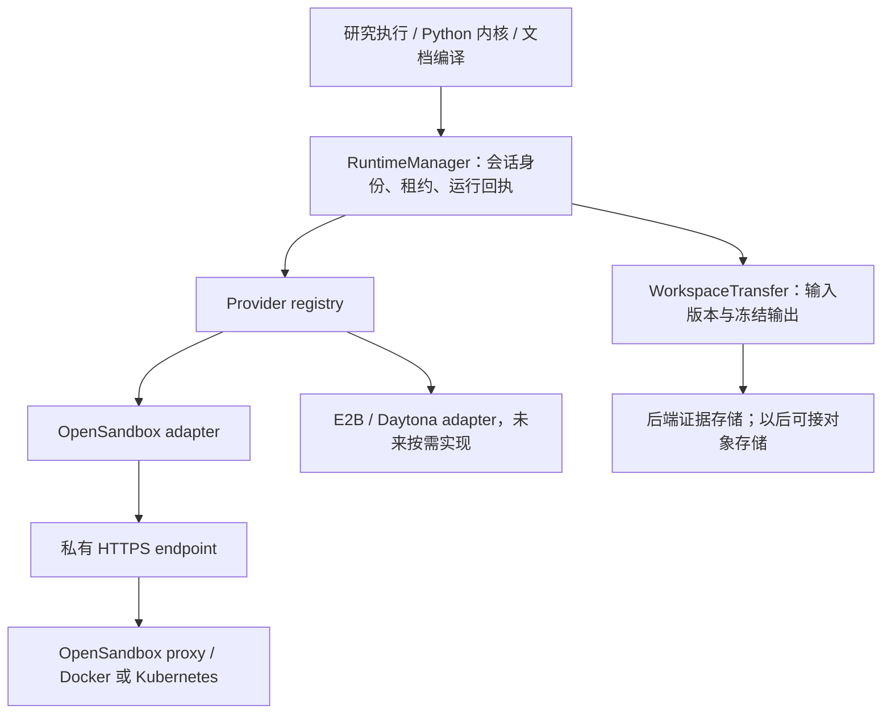

# 沙箱连接与供应商解耦调研

调研日期：2026-10-23。状态：统一接口与适配器入口已实现；后续运行管理架构仍为设计建议。未部署，也未接入第二家真实供应商。既有项目只读导出的架构切换保持不变。

## 已落地的第一步

研究的 `create_kernel` 和编译的 `sandbox_operation` 都通过 `factory.create_session` 选择适配器。唯一正式适配器仍是 OpenSandbox；新增平台在后端启动时注册 `SessionFactory`，不能从模型工具参数动态加载。未知平台、本机回退和重复注册均拒绝。

`SandboxSession` 明确包含 Python 执行、结构化 `exec(argv, stdin, timeout)`、文件传输、冻结输出、重复安全的 `finalize` 和销毁 `close`。编译调用方不再拼 shell 或读取具体适配器的配置；OpenSandbox 适配器负责把参数转换成固定版本 SDK 的命令形式，以及校验 HTTPS/API key/服务器缓存目录。旧环境变量名和 OpenSandbox 缓存键保持兼容，`host_workspace_root` 仍是兼容字段，仅由该适配器要求。

运行记录及编译回执绑定平台类型；恢复时不跨平台读取或重跑。旧编译回执按 OpenSandbox 解释。这里只绑定平台类型，完整部署配置身份、稳定工作区 ID、租约上移及跨进程 attach 仍需下一阶段实现。切换平台遇到现有编译回执时需先恢复原配置处理记录，不会自动复用相同源码的旧回执。

测试使用独立远端目录的替身验证同一注册入口服务两条链路、结构化参数、旧回执恢复、取消与文件交付；这不是实际 RPC 或第二家云平台连通性验收。HTTP/SSE 或 RPC 的具体协议由适配器/官方 SDK 决定，当前不新建网关。

## 建议

保留 OpenSandbox 作为当前执行平台；先把 Python 执行与编译统一经过一个适配器工厂，再用稳定的私有 HTTPS 地址解决部署连通性。SSH 隧道只作为开发或应急部署方式。暂不自建通用沙箱网关，不把各平台包装成一个假装语义相同的 HTTP API。

必须分别处理三个问题：

1. **网络可达性**：后端如何访问执行服务，包括 DNS、TLS、VPN、SSH、Docker 网络。
2. **执行语义**：谁创建/连接/停止沙箱，如何保持解释器、取消执行，以及确认命令是否完成。
3. **文件与证据**：如何上传选定输入、冻结输出、校验下载、保存真实完成回执。

更换网络不应改研究代码；更换供应商只改适配器和运行环境映射。跨供应商移动 Python 内存不是这个抽象的承诺。

## 调研时的耦合点与剩余工作

- 已修正：编译曾直接构造 `OpenSandboxSession`，绕过工厂。现在两条链路使用同一入口。
- 部分拆开：`SandboxSettings` 为配置兼容仍包含连接参数、运行资源和 OpenSandbox 宿主机目录，但连接规则和 bind mount 要求仅由 OpenSandbox 适配器校验。
- 已修正：`SandboxSession` 曾缺少编译调用契约；`release` 实际只是 `close` 别名，契约却暗示保留租约。统一契约现在使用明确的销毁语义，并要求显式 `finalize`（无需额外准备的平台可实现为空操作）。
- `OpenSandboxSession` 自行写后端 lease 文件；租约存储、SDK 生命周期、文件协议混在一个类里。
- 默认 cache key 由后端绝对路径生成。换后端挂载位置可能改变身份；这不应决定能否取回同一次运行的结果。
- SDK 的 `use_server_proxy=True` 是合理的：动态沙箱的数据流量经同一入口，不需要让后端访问每个容器 IP。
- 示例 SSH 仅监听宿主机 loopback，当前 Docker bridge 后端不能通过自己的 loopback 访问它。

## 推荐的最小架构

第一版仍放在后端进程中，不新增必须独立运维的服务。

### 通用契约

- `Provider.create(spec) -> SessionHandle`：返回供应商类型、部署配置 ID、沙箱 ID、工作区 ID、会话代次、到期时间与能力；不返回秘密。
- `Provider.attach(handle)`：重新连接同一沙箱。不存在、过期、无权限分别报告，不能悄悄创建空环境。
- `Session.exec(argv, cwd, timeout)`：供编译与文件辅助程序使用，返回退出码与执行回执；参数使用结构化 argv。
- `Session.python_cell(code, context_id)`：保留同一解释器会话；可由平台解释器 SDK 实现，也可由镜像内受控 worker 实现。
- `Session.interrupt(execution_id)`、`destroy()`、`disconnect()`：区分终止远端资源与关闭客户端；不把“释放租约”隐含为“销毁”。
- 文件上传、下载、stat/list 或 manifest：适配 SDK 文件 API，路径只表示沙箱内相对路径。

供应商能力需要显式声明，例如 `persistent_python`、`attach_running`、`durable_files`、`pause_memory`、`network_deny`、`gpu`。任务要求不满足时，提交前报清楚；文件恢复不能伪装成内存恢复。不要要求所有平台都支持宿主机路径或相同 snapshot 格式。

Python 与编译必须复用同一个 provider registry，不能只把 `create_kernel` 做成可插拔。

### 存储与恢复

保留现有后端权威数据、按哈希传输、冻结产物和原子归档设计。把服务器缓存视为可丢失的加速层；host volume、平台 volume、snapshot 只是各适配器的实现选择。

用持久保存的 `project_id / execution_id / workspace_generation` 标识工作区；历史 cache key 作为旧句柄保留，不能直接换算法造成旧回执失联。运行回执固定绑定 provider 配置 ID、sandbox ID 和缓存/快照身份。修改默认供应商只影响新运行。

平台若不支持跨销毁保存文件，应在销毁前把冻结结果转移到后端或对象存储。尚未取回的唯一输出不能随 TTL 被自动删除；到期无法确认时必须报告缺口。可选对象存储凭据使用短期、限定对象范围的授权，避免把后端完整凭据交给执行代码。

网络中断后的三种状态必须分开：已完成且结果待下载、确认失败、完成情况未知。只有查询状态和下载可以安全重试；未知的代码执行不能跨平台自动重跑。平台原生不提供幂等执行时，应在提交前后记录状态并保留未知结果，不能通过 HTTP 重试机制声称 exactly-once。

## 网络方案比较

| 方案 | 适用情况 | 代价与边界 |
| --- | --- | --- |
| 私网 DNS + HTTPS | 云服务器在同一 VPC，或已有互联网络 | 最直接；应用只配稳定 endpoint，证书和路由由部署管理 |
| Tailscale/WireGuard 私网 + HTTPS | 当前云后端与 ASUS 分处不同网络 | 推荐候选；需验证实际线路、Docker 出站路由、访问策略和断线恢复 |
| SSH 隧道 sidecar/受管服务 | 开发、临时连接、应急 | 保留为可选项；明确共享网络命名空间或用 TLS 代理，不能假设宿主机 localhost 等于容器 localhost |
| 平台托管 HTTPS API | 使用 E2B、Daytona 等托管服务 | 网络简单，但生命周期、模板、存储和能力由适配器映射 |
| 自建统一执行网关 | 多应用、多租户、多平台集中调度以后 | 当前不建议；会新增认证、租约、流式代理、幂等、调度和故障恢复维护工作 |

对当前两台机器，建议评估 Tailscale：ASUS 上保留 OpenSandbox 监听 `127.0.0.1:18080`，通过 Serve 提供 tailnet 内 HTTPS；后端主机或专用 sidecar 加入同一私网。**必须从实际后端容器验证 DNS/TLS/流式响应和大文件传输**，不能只在宿主机 curl 成功就认为完成。使用网络访问策略加 OpenSandbox API key，避免给执行容器加入管理私网。

如果已有 VPC、WireGuard 或别的稳定私网，直接复用，不为此强制引入 Tailscale。VPN 解决网络，不解决 provider API 差异。

## 平台对照与官方依据

| 平台 | 对本项目有用的能力 | 不能统一假设的地方 |
| --- | --- | --- |
| OpenSandbox | server proxy 统一入口；当前已有代码和文件适配器 | 当前项目固定 SDK 1.1.1，官网默认分支可能更新；需要按固定版本验证 API |
| E2B | 官方支持 pause/connect，恢复文件与内存 | 同平台恢复能力，不代表跨供应商可迁移内存；模板与运行策略需独立映射 |
| Daytona | API 控制面、runner 执行面、Toolbox 文件与命令接口；volume 独立于沙箱 | 共享 volume 的并发写和持久化语义不同于本机目录，不能替代不可变证据 |
| Modal | 文件系统/目录快照，以及内存快照 | 内存快照文档标为 Alpha，并存在保留期限和恢复限制；不宜作为最低共同契约 |

上述只是适配可行性分析，不是第二家供应商验收结果，也未对价格、国内连通速度或实际隔离效果作承诺。

参考官方文档：

- [OpenSandbox Python SDK](https://github.com/opensandbox-group/OpenSandbox/blob/main/docs/sdks/python.md)：代理连接和认证。
- [OpenSandbox SDK 版本注意事项](https://open-sandbox.ai/sdks/)：官网默认分支与安装版本可能不同。
- [E2B sandbox persistence](https://docs.e2b.dev/sandbox/persistence)：pause/connect 的状态语义。
- [Daytona architecture](https://www.daytona.io/docs/en/architecture/)：控制面与执行面。
- [Daytona volumes](https://www.daytona.io/docs/volumes/)：volume 生命周期、共享与并发限制。
- [Modal sandbox snapshots](https://modal.com/docs/guide/sandbox-snapshots)：文件与内存快照的差别。
- [Tailscale Docker](https://tailscale.com/docs/features/containers/docker)：容器接入方式。
- [Tailscale Serve](https://tailscale.com/docs/features/tailscale-serve)：tailnet 内 HTTPS 和访问控制。

## 建议落地顺序

1. 先修 CI，把旧路径 fixture、证据归档 fixture、离线执行器与编译器替身更新到当前协议，修复被这些测试揭露的实际读写缺陷。
2. 抽出统一 `create_session` 工厂，让计算与编译都使用；将通用资源要求、OpenSandbox 专用配置和部署网络配置分开。第一步仍只有一个正式 provider。
3. 加持久 SessionHandle 和显式 capabilities，保留旧回执/缓存身份；验证 attach 与 destroy 不混淆。
4. 用独立文件树的协议测试覆盖传输；再做一个不同平台的最小适配 spike，验证 Python 状态、命令退出码、上传下载和中断。测试替身通过不能代替真实平台验收。
5. 部署侧配置私有 HTTPS，并从后端容器执行受控验收：创建、两格变量共享、编译、下载失败重取、重连、超时取消、销毁；同时确认远端不能访问后端状态/密钥。

验收后再决定是否需要对象存储和多节点调度。目前没有必要自建网关或强制 Kubernetes。
